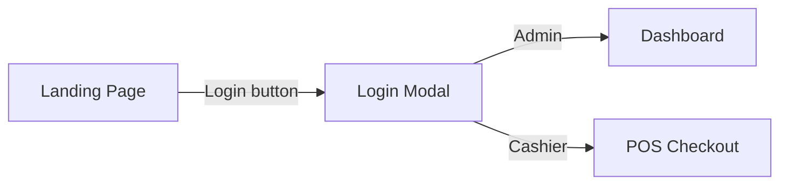
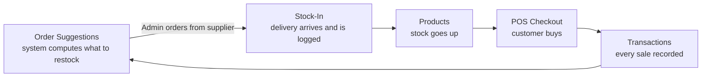

# SmartStock

A web-based Inventory and Point-of-Sale (POS) system built for a hardware store,
with real-time stock tracking, demand forecasting, and role-based access for
Admins and Cashiers.

## Features

- Two-tier role security: Admin (inventory, reports, settings) and Cashier (POS only). No self-registration.
- Real-time stock updates on every delivery and every sale.
- Low-stock alerts when an item hits its reorder threshold.
- Nightly demand forecasting based on the last 30 days of sales.
- Transaction history with CSV export.
- Automatic database backups daily at 2:00 AM (keeps the newest 7).

## System Flow

### 1. Landing Page

Public marketing page with a hero banner, feature highlights, and testimonials.
Guests see a Login button; signed-in users get quick links instead.

### 2. Login

A simple modal popup on the landing page (username and password).
Accounts are created by the Admin only. On success, Admins are redirected to
the Dashboard and Cashiers to the POS Checkout page.



### 3. Dashboard (8 pages)

| Page | Purpose |
|---|---|
| Stock-In | For receiving actual stock items and logging every delivery (product, quantity, supplier, time). Stock goes up. |
| Products | Master list of all items: add, edit, update prices, manual stock adjustments, low-stock indicators. |
| POS Checkout | Cashier sells to customers. Stock goes down and a receipt is generated automatically. |
| Transactions | Record of every sale (receipt number, cashier, total, date) with CSV export. |
| Order Suggestions | Nightly forecast of what to restock and how much. The Admin orders from the supplier, then marks it as "Ordered". |
| Suppliers | Contact directory of the vendors the store buys from. |
| User Accounts | Create and manage Admin and Cashier accounts: activate, deactivate, reset passwords. |
| Backups | Database backups. Runs automatically daily at 2:00 AM and keeps the newest 7. |

### Inventory Cycle

Order Suggestions -> the Admin orders from the supplier -> the delivery arrives
and is logged in Stock-In -> stock goes up in Products -> customers buy through
POS Checkout -> every sale is recorded in Transactions -> the forecast runs again.



## Tech Stack

| Layer | Technology |
|---|---|
| Backend | Laravel 12 (PHP 8.2+) |
| Frontend | Blade templates, Tailwind CSS 4, Vite, Chart.js |
| Database | PostgreSQL (Supabase) |
| Deployment | Docker (Nginx + PHP-FPM + Supervisor) on Render |

## Quick Start

```bash
# One-command setup (install, .env, key, migrate, npm build)
composer setup

# Or step by step
composer install
cp .env.example .env
php artisan key:generate
php artisan migrate
npm install && npm run build

# Run the app, queue, logs, and vite together
composer dev
```

The app expects a Supabase PostgreSQL connection in `.env`
(`DB_CONNECTION=pgsql`). See DEPLOYMENT.md for the full Render + Supabase guide.
