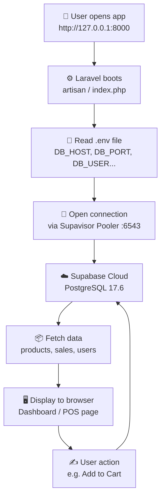

# 🗄️ Database Connection — Smart-Stock

> Simple explanation ng **Supabase database connection** ng Smart-Stock.
> Isinulat sa **3 languages**: 🇵🇭 Filipino, 🇬🇧 English, at 🔀 Taglish (Tagalog+English mix).

---

## 📌 TL;DR (Madali i-intindihin)

Ang Smart-Stock ay may **Supabase** na database (cloud database).
Para makakonekta rito, kailangan ng applet ng app na **alamin kung saan pupunta** — host, port, pangalan ng DB, user, password.

Nasa `.env` ang lahat ng impormasyong ito. Kapag binuksan mo ang app, **basahin ng Laravel ang `.env`**, tapos **mag-connect siya sa Supabase**, tapos **magsasalita na ng data** (products, suppliers, sales).

---

## 🎯 Ano ang purpose?

| Purpose | Explanation |
|---|---|
| **Storage** | Lahat ng data (products, suppliers, sales, users) ay nasa cloud — hindi sa computer mo |
| **Connectivity** | Makinig ang app sa database para malaman kung ano ang laman |
| **Live data** | Pag-save mo ng benta, agad nakikita ng dashboard ang bagsong datos |
| **Security** | Hindi nakikita ng iba ang password mo kasi nasa `.env` (hindi na-commit sa Git) |

---

## 🔄 Ano ang flow? (Paano ito gumagana)



### Sa simple words — step by step:

1. **Bubuksan mo ang app** → `http://127.0.0.1:8000`
2. **Laravel boots** → nagre-read ng `artisan` at `.env`
3. **Basahin ang `.env`** → kinukuha ang settings:
   - `DB_HOST` = **saan** (address ng database)
   - `DB_PORT` = **6383** (port number, like house number)
   - `DB_USERNAME` = ** Sino ka** (user account)
   - `DB_PASSWORD` = **susi** (password)
4. **Mag-connect** → gumagamit ng **Supavisor Pooler** (tagapag-queue ng connections para hindi bumagsak)
5. **Kumuha ng data** → `SELECT * FROM products`
6. **I-display sa browser** → nakikita mo ang table ng products
7. **Pareho pabalik** → kapag ka nag-save, balik na sa database

---

## ⚙️ Ang actual config mo

Nasa [`.env`](./.env) mo ito:

```ini
DB_CONNECTION=pgsql
DB_HOST=aws-0-ap-northeast-1.pooler.supabase.com
DB_PORT=6543
DB_DATABASE=postgres
DB_USERNAME=postgres.vxmyfozpixzbobwnfziq
DB_PASSWORD=••••••••••••
DB_SSLMODE=require
```

### Ano-ano ang ibig sabihin?

| Setting | Value | Kahulugan (easy lang) |
|---|---|---|
| `DB_CONNECTION` | `pgsql` | "Gumamit tayo ng **PostgreSQL** database" |
| `DB_HOST` | `aws-0-ap-northeast-1.pooler.supabase.com` | "Ang **address** ng database nasa AWS Tokyo (ap-northeast-1)" |
| `DB_PORT` | `6543` | "Ang **room number** — 6543. Hindi 5432 kasi nasa pooler tayo" |
| `DB_DATABASE` | `postgres` | "Ang **pangalan ng database**" |
| `DB_USERNAME` | `postgres.vxmyfozpixzbobwnfziq` | "Ang **username** mo sa Supabase (may project ref sa dulo)" |
| `DB_PASSWORD` | *(nakatago)* | "Ang **susi** — huwag ipublish!" |
| `DB_SSLMODE` | `require` | "Kailangan ng **secured connection** (encrypted)" |

### 🔑 Dalawang mode ng Supabase connection

| Mode | Host | Port | Kailangan ng | Gamit saan |
|---|---|---|---|---|
| **1. DIRECT** | `db.XXXX.supabase.co` | `5432` | IPv6 | Migrate / admin commands |
| **2. POOLER** ✅ | `aws-0-ap-NORTHEAST-1.pooler.supabase.com` | `6543` | IPv4 lamang | Globe/PH network, prod (Render) |

**Ikaw ay gumagamit ng POOLER mode** — dahil IPv4 lang ang network sa Pilipinas, at `6543` ang Transaction pooler port.

---

## 🧩 Dalawang file na nag-aalaga dito

### 1. `.env` — Ang settings (secret)
```ini
DB_HOST=aws-0-ap-northeast-1.pooler.supabase.com
DB_PASSWORD=(tingnan ang .env — hindi inilalagay ang totoong password sa docs)
```
- ⚠️ **Hindi** nito ini-commit sa Git (nasa `.gitignore`)
- Ito ang **pinag-iisang source of truth** ng credentials

### 2. `config/database.php` — Ang reader (logic)
```php
'default' => env('DB_CONNECTION', 'pgsql'),

'pgsql' => [
    'driver'   => 'pgsql',
    'host'     => env('DB_HOST', '127.0.0.1'),
    'port'     => env('DB_PORT', '5432'),
    'database' => env('DB_DATABASE', 'postgres'),
    'username' => env('DB_USERNAME', 'postgres'),
    'password' => env('DB_PASSWORD', ''),
    'sslmode'  => env('DB_SSLMODE', 'require'),
    'search_path' => 'public',
    // Pooler fix: Transaction/Session pooler ayaw sa native PREPARE
    'options'  => [2 => 10],   // statement timeout = 10s
],
```

Ito ang **humahawak** ng credentials mula `.env` at ipinapasa sa PDO (ang PHP driver na nag-connect sa PostgreSQL).

---

## 📊 Ang datos mo ngayon

| Table | Rows | Ano ito? |
|---|---:|---|
| `users` | 5 | 5 accounts (admin1, cashier, cashier2, testuser, owner) |
| `products` | 16 | 16 items sa catalog |
| `suppliers` | 7 | 7 supplier ng hardware |
| `sales` | 63 | 63 transactions |
| `sale_items` | 123 | 123 linya ng mga binili |
| `stock_ins` | 15 | 15 stock-in records |
| `order_suggestions` | 12 | 12 suggested orders (auto-compute) |

---

## ✅ Status: HEALTHY!

```
connection: pgsql ✓
db: postgres ✓
server version: PostgreSQL 17.6 ✓
SSL: require ✓
migrations: 19/19 Ran ✓
queries: working ✓
```

---

---

# 🇵🇭 FILIPINO — Simpleng Paliwanag

## Ano ang "database connection"?

Isang **tugon** (link) ng iyong app sa **Supabase** — isang database na nasa **cloud** (ibabaw ng internet), hindi sa computer mo.

## Bakit kailangan?

Kung walang database connection, **wala kang makikitang produkto, supplier, o sales**. Ang database ay ang **kotse ng lahat ng datos** mo — dito nakasulat lahat.

## Paano ito gumagana?

1. **Bubuksan mo ang app** (hal. `127.0.0.1:8000`)
2. **Babasa ng address** — titingnan ng app kung saan ang database (mula sa `.env`)
3. **Magsisimula ng handshake** — ipinapakita ang username at password
4. **Papasok sa database** — tulad ng pagpasok sa iyong bahay gamit ang susi
5. **Hihingi ng datos** — "Eto sana ang mga produkto, paketo"
6. **Ipapakita sa screen** — makikita mo na ang products page

## Ano ang Pooler?

Kung maraming user ang sabay-sabay na nag-connect, maaaring ma-overload ang database. Ang **pooler** (tagapag-queue) ang humahawak ng mahabang pila — siya ang nagbibigay ng turn ng bawat user.

## Ano ang SSL?

Ang `sslmode=require` ay nagsasabing **naka-encrypt ang data** mo habang naglalakbay — parang naka-lock na kotse. Kahit may makinag, hindi mabasa.

## Bakit `northeast-1`?

Nasa **Tokyo, Japan** ang server (pinakamalapit sa Pilipinas kaya mabilis).

## Mahalaga ba ito?

**Oo!** Ito ang **puso** ng app mo. Kung bigo ang connection, **wala** yung maipapakita.

---

# 🇬🇧 ENGLISH — Simple Explanation

## What is a "database connection"?

A **link** between your application and **Supabase** — a database that lives in the **cloud** (over the internet), not on your computer.

## Why do you need it?

Without a database connection, you **can't see any products, suppliers, or sales**. The database is the **storage room** where all your data is kept.

## How does it work?

1. **You open the app** (e.g. `127.0.0.1:8000`)
2. **The app reads the address** — it checks the `.env` file to learn where the database is
3. **The handshake happens** — it sends your username and password
4. **The connection opens** — like unlocking a door with your key
5. **Data is requested** — "Please give me the products list"
6. **Results are displayed** — you now see the products table

## What is a Pooler?

If many users connect at the same time, the database can get overloaded. The **pooler** is like a **queue manager at a store** — it hands out turns one at a time.

## What is SSL?

`sslmode=require` means the data is **encrypted** while traveling — like a locked truck. Even if someone tries to peek, they can't read it.

## Why `northeast-1`?

The server lives in **Tokyo, Japan** (closest to the Philippines = fastest speed).

## Is it important?

**Yes!** This is the **heart** of your app. If the connection breaks, everything becomes **empty**.

---

# 🔀 TAGLISH (Tagalog + English Mix)

## Ano ba talaga yung "database connection"?

Yun yung **link** ng app mo sa **Supabase**. Ang Supabase ay **cloud database** — nasa **internet**, hindi sa laptop mo. Parang **Google Drive** pero para sa inventory data mo.

## Bakit kailangan nito?

Kung **walang connection**, **wala kang makikita** — walang products, walang suppliers, walang sales. Ang database ay parang **storage room** ng store mo. Lahat ng datos nandoon.

## Paano ba ito gumagana?

1. **Bubuksan mo ang app** → `127.0.0.1:8000`
2. **Babasa ng config** → hanapin ng app kung saan ang database (tinaas sa `.env`)
3. **Mag-ha-handshake** → ipinapasa ang username + password
4. **Mag-connect** → parang binubuksan ang pintuan gamit ang key
5. **Request ng data** → "Pakita na please, mga products"
6. **Display sa screen** → yay! Nakikita mo na ang products table

## Bakit may Pooler (6543)?

Kung maraming cashier na sabay-sabay na nag-`Add to Cart`, maaari ma-**overload** ang database. Ang pooler ang parang **teller** sa bank — nagsasaad ng turn, isa-isa. Kaya safe ka.

## Bakit SSL `require`?

Para **encrypted** ang data habang naglalakbay. Parang **locked van** — kahit may manonood, hindi mabuksan. Secure ang credentials mo.

## Bakit `ap-northeast-1`?

Nasa **Tokyo** ang server. Pinakamalapit sa Pilipinas kaya **mabilis** ang response.

## Okay ba ito?

**Legit!** Ito ang **puso ng app** mo. Pagka-break ng connection → **empty** lahat ng page. Pero ngayon? **Healthy** — 19 migrations ran, 63 sales recorded, lahat gumagana.

---

## 🎯 TL;DR sa 3 languages

| Language | One-liner |
|---|---|
| 🇵🇭 Filipino | Ang database connection ang **tugon** ng app mo sa Supabase — para ma-fetch ng products, suppliers, at sales. |
| 🇬🇧 English | The database connection is your app's **link** to Supabase — so it can fetch products, suppliers, and sales. |
| 🔀 Taglish | Ang connection ang **bridge** ng app mo papunta sa Supabase — kaya nakikita mo ang lahat ng data mo! |

---

*Generated: 2026-10-02 · Smart-Stock Inventory System*