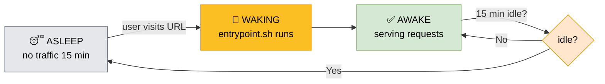

# Render Deployment Workflow

Smart-Stock uses **Render Blueprint** for automatic deployment. Every push to the `main` branch triggers Render to build a Docker image (3-stage: Composer → Node → Production) and deploy it as a web service on the free tier. The container runs nginx + php-fpm managed by supervisor, connecting to Supabase PostgreSQL via the pooler on port 6543. Environment variables (DB credentials, APP_KEY) are stored as secrets in Render and injected at runtime via the entrypoint script.

---

## Render Workflow Summary

| Aspect | Details |
|--------|---------|
| **Trigger** | Auto-deploy on every push to `main` branch |
| **Configuration** | `render.yaml` (Infrastructure as Code) |
| **Build Process** | Docker multi-stage build (3 stages) |
| **Runtime** | Single container: nginx + php-fpm + supervisor |
| **Database** | Supabase PostgreSQL via pooler (port 6543) |
| **Secrets** | Stored in Render dashboard (APP_KEY, DB_PASSWORD) |
| **Region** | Singapore (close to Philippines) |
| **Plan** | Free tier (sleeps after 15 min idle) |
| **Live URL** | `https://smart-stock-4lav.onrender.com` |
| **TLS / DNS** | Provider-managed certificate with auto-renew; nothing to do |
| **Health Check** | `GET /` returns 200 OK |
| **Logs** | stdout/stderr (visible in Render dashboard) |

---

## Sleep / Wake Cycle (Free Tier)

| State | Condition | What Happens | User Impact |
|-------|-----------|--------------|-------------|
| **AWAKE** | A request arrived in the last 15 minutes | Container serves requests normally | Fast response |
| **ASLEEP** | No traffic for 15 minutes | Render stops the container to free resources | — |
| **WAKING** | A user visits the URL | Render restarts the container, re-runs `entrypoint.sh` | First request takes 30–60 seconds (cold start) |

> ⚠️ **Why `SESSION_DRIVER=file` is safe here:** Render runs only **ONE** container at a time, so nginx and php-fpm share a single session store. If multiple instances were added, this would have to move to the `database` driver or sessions would be lost on every cold start.

---

## Deployment Pipeline Steps

1. **Developer** pushes code to GitHub `main` branch
2. **Render** detects change via webhook → reads `render.yaml`
3. **Docker build** runs 3 stages: (1) Composer installs PHP deps, (2) Node compiles Vite assets, (3) Final image with nginx + php-fpm
4. **Entrypoint script** sets up runtime: generates APP_KEY if missing, caches config, generates nginx config with `envsubst`
5. **Supervisor** starts nginx (web server) + php-fpm (PHP processor)
6. **Application** serves requests and connects to Supabase database

---

## Key Files

| File | Purpose |
|------|---------|
| `render.yaml` | Render Blueprint configuration (service definition, env vars) |
| `Dockerfile` | Multi-stage Docker build definition |
| `docker/entrypoint.sh` | Runtime setup (PORT, APP_KEY, nginx config, Laravel caches) |
| `docker/supervisor/supervisord.conf` | Process management (nginx + php-fpm) |
| `docker/php/www.conf` | PHP-FPM pool configuration (unix socket, env inheritance) |
| `docker/nginx/default.conf.template` | Nginx config template (port substitution) |

---

## Environment Variables (from render.yaml)

| Category | Variables |
|----------|-----------|
| **Laravel** | `APP_ENV=production`, `APP_DEBUG=false`, `LOG_CHANNEL=stderr` |
| **Database** | `DB_CONNECTION=pgsql`, `DB_HOST`, `DB_PORT=5432`, `DB_DATABASE=postgres`, `DB_USERNAME`, `DB_PASSWORD`, `DB_SSLMODE=require` |
| **Session/Cache** | `SESSION_DRIVER=file`, `CACHE_STORE=file` |
| **Queue** | `QUEUE_CONNECTION=null` (disabled on free tier) |
| **Security** | `SESSION_SECURE_COOKIE=true`, `SESSION_HTTP_ONLY=true`, `SESSION_SAME_SITE=lax` |
| **Secrets** | `APP_KEY` (sync: false), `DB_PASSWORD` (sync: false) |
| **Application** | `APP_URL=https://smart-stock-4lav.onrender.com` |

---

## Live App URL & DNS / TLS

| Item | Value |
|------|-------|
| **Test / Production URL** | `https://smart-stock-4lav.onrender.com` |
| **Protocol** | HTTPS (TLS terminated at the Render edge) |
| **Certificate** | Provider-managed, auto-renewing — nothing to configure |
| **DNS** | Provider-managed subdomain; no custom domain yet |
| **Health check path** | `/` — Render calls it and expects a 200 |
| **Assigned in** | `render.yaml` → `APP_URL` env var |

> The URL is derived from the Render service name. If the service is renamed, the hostname changes and `APP_URL` must be updated to match, otherwise Laravel generates links against the wrong domain.

---

## Why This Setup?

- **No GitHub Actions needed** — Render handles deployment via Blueprint
- **Single container** — simpler to manage, cheaper on free tier
- **Multi-stage build** — smaller image size, faster builds
- **Supervisor** — runs nginx + php-fpm as separate processes in one container
- **Unix socket** — faster communication between nginx and php-fpm
- **Entrypoint script** — handles runtime setup (APP_KEY generation, config caching)
