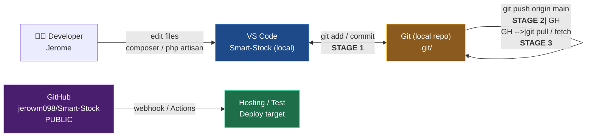
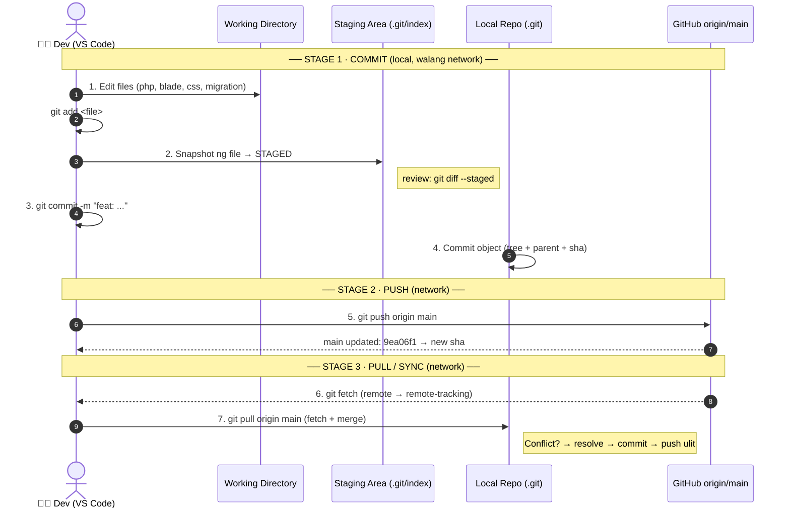
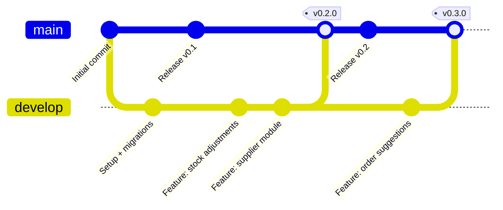
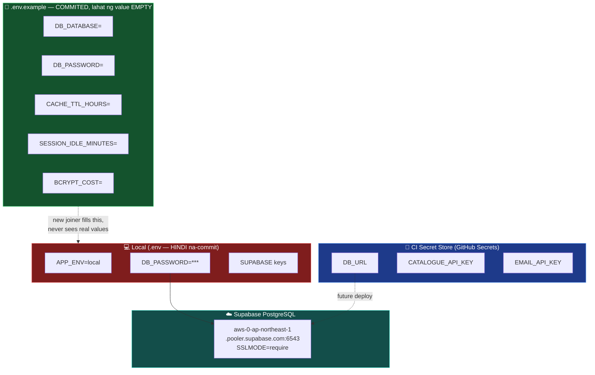
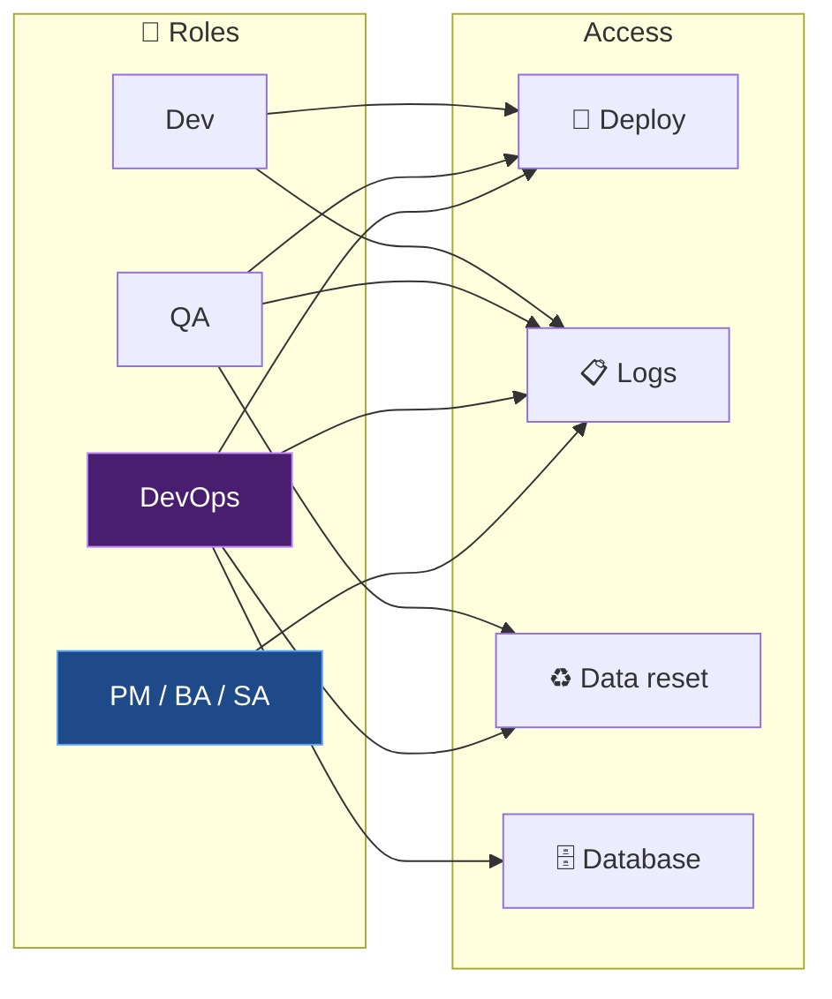
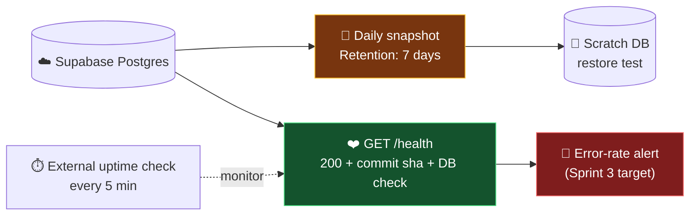

# Diagram 1 — GitHub Repository ↔ VS Code: Connection, Push, Merge, Stages

> Reference base: `files/Infrastructure & Workflow - mam inda.pdf` (Environments Overview, Deployment Process, Configuration Management, Secrets, Migrations, Backup & Restore, Monitoring, Access/Cost/Limits)
> Actual state ngayon: repo `jerowm098/Smart-Stock` (PUBLIC, default branch `main`)

---

## 1.1 — Overview ng Connection

**Paano sila magkakaugnayan (mechanics):**

| Layer | Ano ang nangyayari |
|---|---|
| **VS Code (editor)** | Nag-iikli ng code. Hindi ito ang nag-iimbak ng history — ang `.git/` folder ang source of truth ng history. |
| **Local Git repo** | `.git/` folder sa loob ng project. Dito nabubuo ang `index` (staging area) at ang commit objects. |
| **Remote (`origin`)** | `https://github.com/jerowm098/Smart-Stock.git` — HTTPS protocol. |
| **GitHub** | Central server ng history + collaboration (PR, Issues, Actions, branch protection). |

---

## 1.2 — Ang 3 Yugto ng Push & Merge (stages)

**Kung "stage" ang tinutukoy ng PDF (Sprint release):**

| Stage | Trigger | What happens | Gate |
|---|---|---|---|
| **Stage 1 — Local commit** | `git add` + `git commit` | Commit object ang nabubuo. Walang network. | Wala (developer lang) |
| **Stage 2 — Push to `develop`** | `git push origin develop` | Auto-deploy sa **Test** (ayon sa PDF: "Every merge into develop deploys to Test automatically") | Pipeline green |
| **Stage 3 — PR `develop` → `main`** | Release pull request | Ang ticket list sa PR description = release notes | ✅ **Tanging manual gate** — DevOps + PM approval |
| **Stage 4 — Tag + release** | `git tag v0.<n>.0` | Tag → Staging → Production (naka-pending pa ang MT-201/MT-202) | Smoke check |

---

## 1.3 — Branching Model (kasalukuyang estado)

| Branch | Purpose | Naka-merge na sa `main`? |
|---|---|---|
| `main` | Production / stable release. **Default branch** ng GitHub. | — |
| `develop` | Integration branch. Every merge dito = auto Test deploy. | ✅ naka-sync |

> ⚠️ **Note:** Walang `.github/workflows/` folder ang repo — kaya **wala pang actual na GitHub Actions pipeline**. Ang PDF ay *reference/target* na "SAMPLES FOR YOUR REFERENCE", hindi kasalukuyang implementasyon.

---

## 1.4 — Mga Secrets & Config ((Configuration Management)

**Rules mula sa PDF (na.apply na sa setup natin):**

1. ✅ Read once at start-up, validate, **never default silently**
2. ✅ `.env.example` committed with empty values
3. ✅ Secrets sa CI secret store — **hindi** sa repo
4. ✅ Secrets **masked in logs** — huwag ever `echo $SECRET`

---

## 1.5 — Mga Access Role

> **Ngayon:** Single-developer setup — si `jerowm098` ang may **full** access (owner).

---

## 1.6 — Backup & Monitoring (target state mula sa PDF)

> ⚠️ **Hindi pa implemented:** Walang `/health` route, walang automated backup, walang alerting. Ito ang *target state* na dapat gawin bago mag-Production.

---

## 1.7 — Buod: Pipeline ng Isang Release

```mermaid
flowchart LR
    CODE["💻 Code<br/>committed"] --> BR["🌿 push to develop"]
    BR --> PIPE["⚙️ Pipeline<br/>Stages 1–6"]
    PIPE --> MIG["🗄️ Migrate<br/>(reviewed file)"]
    MIG --> DEP["🚀 Deploy → Test"]
    DEP --> SMOKE["🩺 Smoke check<br/>GET /health = 200 + sha"]
    SMOKE --> PR["📋 PR: develop → main"]
    PR --> APPR["✅ Approve<br/>DevOps + PM<br/><i>ONLY manual gate</i>"]
    APPR --> TAG["🏷️ Tag v0.n.0"]
    TAG --> STG["🧪 Staging"]
    STG --> PROD["🏭 Production"]
    PROD --> VER["✅ Verify<br/>3 main journeys by hand"]
    VER --> ANN["📣 Announce<br/>Teams channel"]

    style APPR fill:#7f1d1d,stroke:#f87171,color:#fff
    style SMOKE fill:#14532d,stroke:#4ade80,color:#fff
    style PROD fill:#4a1e6e,stroke:#c084fc,color:#fff
```

**Pre-deploy checklist** (mula sa PDF):
- [ ] Pipeline green sa `develop`, kasama ang authorization stage
- [ ] Migrations reviewed ng iba (hindi ng author) + backward compatible
- [ ] Walang bagong config value na missing sa target environment
- [ ] **Walang secret na na-add sa repository**, kahit sa reverted commit
- [ ] Demo dry run done
- [ ] May available na tao sa loob ng susunod na oras
