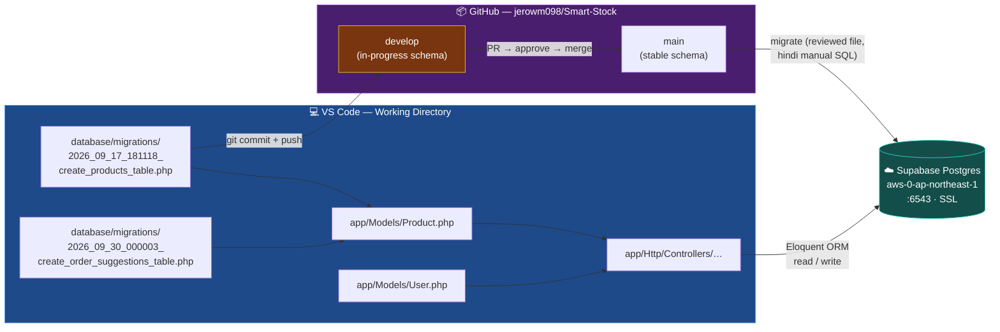
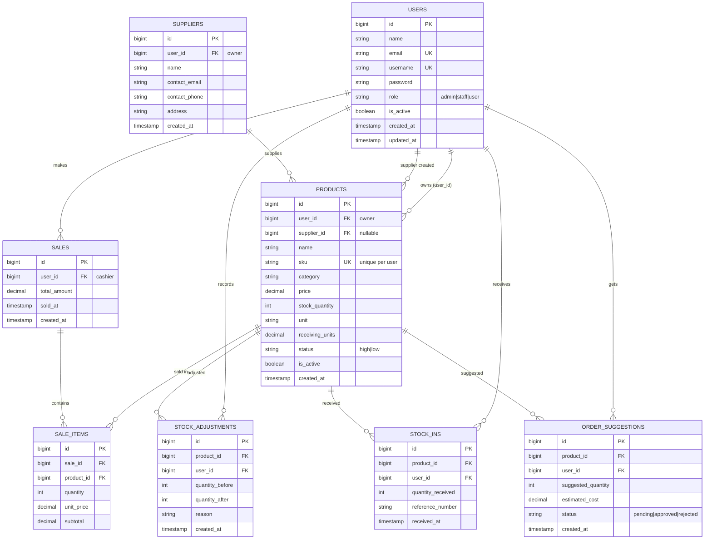
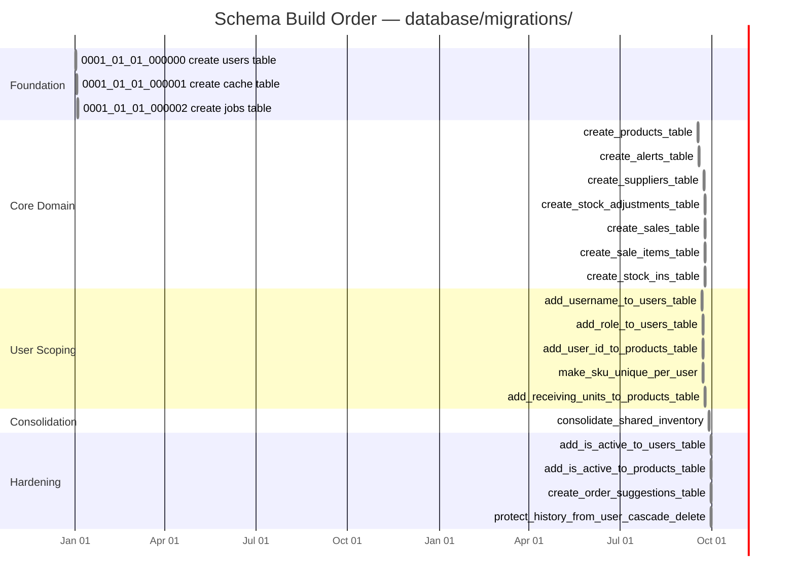
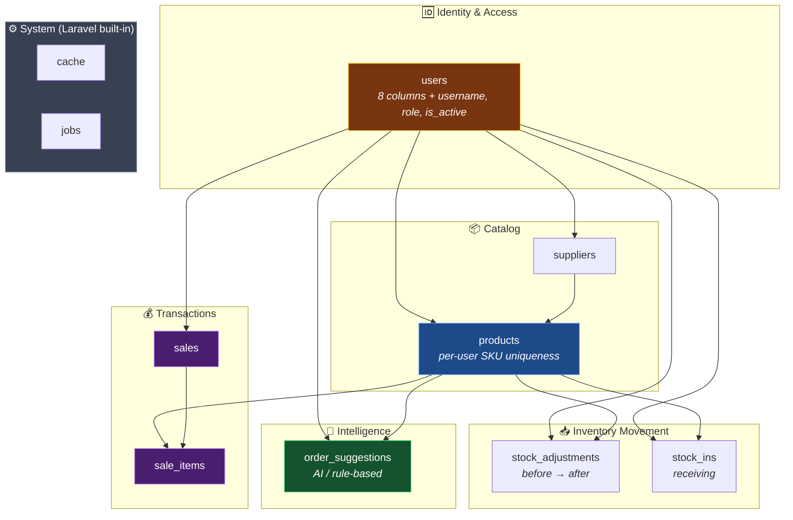
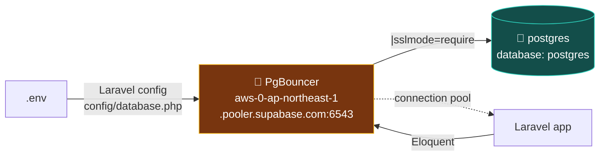

# Diagram 2 — Tables Structure: GitHub ↔ VS Code ↔ Database

> Repo: `jerowm098/Smart-Stock` (Laravel 12, PHP 8.2)
> Database: **Supabase PostgreSQL** via PgBouncer (port `6543`, `DB_SSLMODE=require`)
> Source of schema truth: `database/migrations/` — **hindi** ang live DB ang ina-source ng schema.

---

## 2.1 — Paano dumadaloy ang data: VS Code → GitHub → Database



> 🔑 **Rule mula sa PDF:** *"Every schema change is a reviewed file in the repository. No hand-edited databases, ever."* Ang schema ay **code**, hindi database state.

---

## 2.2 — Database Schema (ER Diagram)



---

## 2.3 — Migration Timeline (order matters!)



> ⚠️ **Migration ordering gotcha:** Ang timestamps ay **hindi chronological** sa pinakahuling batch — `2026_09_21_*` (add_user_id) ay lumagpas sa `2026_09_23_*` (create_sales). Laging tingnan ang **filename**, hindi ang dami.
>
> ✅ **Safe:** `protect_history_from_user_cascade_delete` — pinoprotektahan ang historical records (Sales, StockAdjustments) kapag ang user ay tinanggal. Tugma ito sa PDF rule: *"A destructive change is split in two: release n stops using the column, release n+1 drops it."*

---

## 2.4 — Table Categories



| Table | Purpose | Key Constraint |
|---|---|---|
| `users` | Accounts + roles | `email` & `username` unique, soft-disabled via `is_active` |
| `products` | Inventory master | `sku` **unique per user** (multi-tenant scoping) |
| `suppliers` | Vendor registry | Scoped per user |
| `sales` / `sale_items` | POS transactions | `sale_items` = line items w/ price snapshot |
| `stock_adjustments` | Audit trail | Stores `quantity_before` + `quantity_after` |
| `stock_ins` | Receiving log | References product + user |
| `order_suggestions` | Replenishment proposals | Status workflow: pending → approved/rejected |
| `cache` / `jobs` | Laravel internals | System-managed, huwag gawing manually |

---

## 2.5 — Data Lifecycle: Dev → Prod

```mermaid
flowchart LR
    subgraph LOCAL["💻 VS Code Local"]
        W["Working file<br/>ProductSeeder.php"]
        ST["git add → STAGE"]
        CM["git commit<br/><i>schema + data definition</i>"]
    end

    subgraph GH["📦 GitHub"]
        DV["develop branch"]
        PR["Pull Request<br/>review: migration backward-compatible?"]
        MN["main branch<br/>tag v0.n.0"]
    end

    subgraph DB[("☁️ Supabase")]
        EMPTY[("🧪 Empty DB<br/>CI migration test")]
        PROD[("🏭 Live DB<br/>migrate only")]
        SNAP[("💾 Snapshot<br/>7-day retention")]
    end

    W --> ST --> CM --> DV
    DV --> PR
    PR -->|"review ✅"| MN
    MN -->|"php artisan migrate"| EMPTY
    EMPTY -->|"pass?"| PROD
    PROD --> SNAP
    SNAP -.->|"restore drill<br/>before Sprint review"| EMPTY

    style PR fill:#7f1d1d,stroke:#f87171,color:#fff
    style EMPTY fill:#14532d,stroke:#4ade80,color:#fff
    style PROD fill:#4a1e6e,stroke:#c084fc,color:#fff
```

**Mga rules mula sa PDF na saklaw ng diagram:**

| Rule | Saan nakikita |
|---|---|
| Schema change = reviewed file, hindi hand-edit | `database/migrations/` lamang ang source |
| Migrations run against empty DB every CI run | `EMPTY` node — "free test of the migration path" |
| Applied by the pipeline, never by a person | `MN → PROD` edge |
| Backwards-compatible for one release | PR review checkpoint |
| Destructive change split in two releases | `protect_history_from_user_cascade_delete` |
| 7-day snapshot retention | `SNAP` node |

---

## 2.6 — Connection String Breakdown



| Setting | Value | Note |
|---|---|---|
| `DB_CONNECTION` | `pgsql` | PostgreSQL driver |
| `DB_HOST` | `aws-0-ap-northeast-1.pooler.supabase.com` | Supabase **pooler** (not direct) |
| `DB_PORT` | `6543` | ⚠️ **Transaction mode** pooler — hindi `5432` |
| `DB_DATABASE` | `postgres` | Default project DB |
| `DB_USERNAME` | `postgres.<project-ref>` | Supabase scoped user |
| `DB_SSLMODE` | `require` | Encrypted connection |

> 🔒 **Erasure obligation:** Ang 7-day snapshot window + 7-day erasure obligation ay magkasalungat. Isang account na binura ngayon, nandoon pa rin sa snapshots ng isang linggo — kaya't *"within seven days"* ang sinulat sa requirement, hindi *"immediately"*.

---

## 2.7 — Connection: GitHub Tables ↔ VS Code Tables

```mermaid
flowchart LR
    subgraph GH["📦 GitHub — Versioned Schema"]
        GF1["📄 database/migrations/<br/>21 migration files"]
        GF2["🏭 database/factories/<br/>Product · StockIn · Supplier · User"]
        GF3["🌱 database/seeders/<br/>Product · Sale · Supplier"]
    end

    subgraph VS["💻 VS Code — Application Layer"]
        V1["🧩 app/Models/<br/>8 models"]
        V2["🎮 app/Http/Controllers"]
        V3["👁️ resources/views/"]
        V4["🛣️ routes/web.php"]
        V5["⚙️ app/Services/"]
    end

    subgraph DB[("☁️ Supabase — Runtime Data")]
        D1["users"]
        D2["products"]
        D3["suppliers"]
        D4["sales"]
        D5["sale_items"]
        D6["stock_adjustments"]
        D7["stock_ins"]
        D8["order_suggestions"]
    end

    V4 --> V2 --> V1
    V5 --> V1
    V1 -->|"Eloquent models<br/>map 1:1 sa tables"| D1
    V1 --> D2
    V1 --> D3
    V1 --> D4
    V1 --> D5
    V1 --> D6
    V1 --> D7
    V1 --> D8

    GF1 -.->|"defines"| D2
    GF1 -.->|"defines"| D8
    GF2 -.->|"feeds"| V1
    GF3 -.->|"seeds"| DB

    style GH fill:#4a1e6e,stroke:#c084fc,color:#fff
    style VS fill:#1e4a8a,stroke:#60a5fa,color:#fff
    style DB fill:#134e4a,stroke:#2dd4bf,color:#fff
```

| GitHub holds | VS Code holds | Supabase holds |
|---|---|---|
| **Definition** — migrations, models, factories, seeders | **Definition** — same files + controllers, views, routes, services | **Runtime data** — actual rows |
| Versioned, reviewed, merged via PR | Working copy, uncommitted changes possible | Mutable, no history |
| Source of truth for schema ✅ | Source of truth for logic ✅ | Disposable (backed up 7d) |

---

## 📌 Buod

1. **Schema = code.** Ang lahat ng table structure ay nasa `database/migrations/` at naka-version sa GitHub. Hindi ka kailanman mag-hahawo-edit ng DB.
2. **Connection path:** VS Code → Eloquent Models → PgBouncer (`:6543`) → Supabase Postgres.
3. **8 domain tables** + 2 Laravel system tables (cache, jobs).
4. **Migration filename** ang tumatakda sa execution order — hindi ang petsa.
5. **Ang PDF ay target/reference**, hindi kasalukuyang estado. Kulang pa: CI pipeline, `/health` endpoint, automated backup, alerting.
